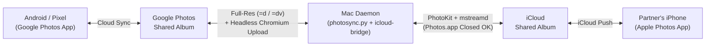

# PhotoSync

**Two-way background bridge between a Google Photos Shared Album (Android / Pixel) and an Apple iCloud Shared Album (iPhone) using a Mac.**

[](LICENSE)
[-000000)](https://github.com/kuscher/photosync)
[](https://github.com/kuscher/photosync)

<sub>A personal passion project by <a href="https://github.com/kuscher">Alexander Kuscher</a>. Not affiliated with, sponsored, or endorsed by any employer.</sub>

---

## Why This Exists in Plain English

This project exists for one main reason: **so my SO and I can share a single photo album where photos and videos I share from my Pixel into Google Photos automatically show up in her iCloud Shared Album on her iPhone — and photos she drops into her iCloud Shared Album automatically show up in my Google Photos album — until she finally ditches her iPhone to join the Android revolution :)**

Since Apple refuses to open iCloud Shared Albums to Android (beyond a static read-only web link) and Google restricted third-party OAuth `photoslibrary.readonly` access in March 2025, **PhotoSync** uses an always-on Mac at home as a silent, two-way bridge between both ecosystems:

1. **Pixel / Google Photos → Partner's iPhone (iCloud Shared Album):**
   `photosync.py` polls your Google Photos shared album link, downloads newly added photos (`=d`) and videos (`=dv`) at full original resolution with all EXIF and GPS metadata intact, and calls `bin/icloud-bridge` to publish them directly into your iCloud Shared Album.
2. **Partner's iPhone (iCloud Shared Album) → Pixel / Google Photos:**
   `bin/icloud-bridge` asks macOS's `CoreMediaStream` (`mstreamd`) daemon to refresh the iCloud Shared Album, exports newly added photos and videos via `PHAssetResourceManager`, and `photosync.py` uploads them into your Google Photos shared album using a dedicated persistent Chrome profile (`~/.local/share/photosync/google-profile`).
3. **Works Even When `Photos.app` Is Closed:**
   `bin/icloud-bridge` does **not** use AppleScript or UI automation and does **not** require `Photos.app` to be open. It talks directly over XPC to macOS's background system daemons (`photolibraryd` and `com.apple.mediastream.mstreamd`) via `PhotoKit` (`PHCollectionShareChangeRequest` + `PHShareAssetChangeRequestHelper`) and `CoreMediaStream` (`MSASConnection`).



---

## Features

- **100% Headless iCloud Shared Album Publishing (`Photos.app` Can Stay Closed):**
  Apple's public `PhotoKit` API blocks `PHAssetCollectionChangeRequest` on iCloud Shared Albums (`PHCollectionShare`, subtype `101`). `icloud-bridge.swift` bridges directly into `PHCollectionShareChangeRequest` and `PHShareAssetChangeRequestHelper` (`addAssetsToSharedStreamShare:creationOptionsPerAsset:withBatchCommentText:`) and triggers `MSASConnection` (`refreshContentOfAlbumWithGUID:resetSync:personID:`) so imports and exports happen silently through `photolibraryd` and `mstreamd` in the background.
- **Full-Resolution Originals with EXIF & GPS Preserved:**
  Downloads original Google Photos assets (`=d` for images, `=dv` for videos) and exports full-size iCloud assets (`PHAssetResourceManager`) without re-encoding.
- **Loop-Free Two-Way Deduplication:**
  Tracks every synced item across Google `media_key`, iCloud `localIdentifier`, file SHA-256 hash, and EXIF creation timestamp in `~/.local/share/photosync/state.json` so synced photos and burst shots never bounce back and forth.
- **Native macOS Menu Bar App (`PhotoSync.app`):**
  - **Filled photo stack (`photo.on.rectangle.angled.fill`)** + vibrant **green status dot (`●`)** when actively watching both albums; **outline icon (`photo.on.rectangle.angled`)** + **red dot** when stopped.
  - Shows live item counts in both iCloud and Google Photos, time since last check, and the most recent transfer.
  - One-click **Sync Now (`⌘S`)**, **Open Google Photos Shared Album (`⌘G`)**, **Open Apple Photos (`⌘P`)**, **Start / Stop PhotoSync**, and **Restart PhotoSync Now (`⌘R`)**.
  - Built-in **How-To & Setup Guide (`⌘I`)** (`onboarding.html`), **Sign in to Google Photos (Chrome)…**, and **Run Setup Wizard in Terminal…**.

---

## Quick Start

### Prerequisites
- A **Mac** running macOS 14 (Sonoma) or newer, signed into your Apple ID with **Photos → Settings → iCloud → Shared Albums** enabled.
- An **iCloud Shared Album** shared with your partner (e.g., `"The Kingpins"`).
- A **Google Photos Shared Album** with **Link sharing** and **Collaborate (Let others add their photos)** enabled.
- **Google Chrome** installed at `/Applications/Google Chrome.app` (used once to sign into a dedicated profile for iCloud → Google uploads).

### One-Command Interactive Setup

Clone the repo and run `./setup.sh`:

```bash
git clone https://github.com/kuscher/photosync.git ~/projects/PhotoSync
cd ~/projects/PhotoSync
./setup.sh
```

`./setup.sh` handles the entire setup:
1. Checks for **Xcode Command Line Tools** (`swiftc`) and triggers the macOS installer if missing.
2. Compiles the native Swift PhotoKit bridge (`bin/icloud-bridge`) with embedded `Info.plist` (`NSPhotoLibraryUsageDescription`).
3. Creates an isolated Python 3.10+ virtualenv at `~/.local/share/photosync/venv` and installs `playwright`.
4. Prompts for your **iCloud Shared Album name**, **Google Photos Shared Album link**, and **poll interval** (saved to `~/.config/photosync/config.json`) and verifies that `bin/icloud-bridge` can read your iCloud Shared Album.
5. Optionally opens a Chrome window once (`--login-google`) so you can sign into your Google account for iCloud → Google Photos uploads.
6. Compiles `~/Applications/PhotoSync.app`, installs the login `launchd` agent (`~/Library/LaunchAgents/io.github.kuscher.photosync-menubar.plist`), and starts both the background sync daemon and the menu bar monitor.

---

## Configuration Reference

Configuration is stored in `~/.config/photosync/config.json` (created by `./setup.sh` or `./setup.sh --reconfigure`):

```json
{
  "icloud_album": "The Kingpins",
  "google_album_url": "https://photos.app.goo.gl/YOUR_SHARED_ALBUM_LINK",
  "poll_interval_seconds": 30
}
```

---

## Useful Commands

| Task | Command |
| :--- | :--- |
| **Re-run interactive configuration** | `~/projects/PhotoSync/setup.sh --reconfigure` |
| **Sign in to Google Photos (one-time)** | `~/.local/share/photosync/venv/bin/python3 ~/projects/PhotoSync/photosync.py --login-google` |
| **Run a single sync cycle manually** | `~/.local/share/photosync/venv/bin/python3 ~/projects/PhotoSync/photosync.py --once` |
| **List items in iCloud Shared Album** | `~/projects/PhotoSync/bin/icloud-bridge list --album "The Kingpins"` |
| **Tail the live sync log** | `tail -f ~/Library/Logs/photosync.log` |
| **Inspect live status JSON** | `cat /tmp/photosync-status.json` |

---

## About This Project

This is a personal passion project by [Alexander Kuscher](https://github.com/kuscher). It is not affiliated with, sponsored, or endorsed by any employer.

## License

MIT License — see [LICENSE](LICENSE).
